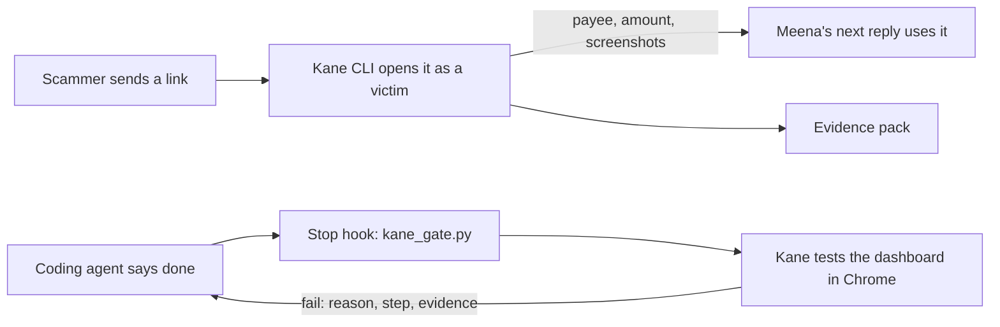

# SCAM-BAIT


**An AI scam-baiter whose hands are Kane CLI.** Scammers send links. Most tools block them. SCAM-BAIT follows them:
Kane opens every link a scammer sends in a real browser, walks through it like a victim, stops before any money
moves, and comes back with proof of who gets paid. Meena, a slow and worried grandmother, uses that proof in her next
reply to keep the scammer talking, and the case leaves with a police-ready evidence pack.

Built for the [KaneCLI Hack Day](https://www.kaneclihack.sh/) by TestMu AI.

## What it does

- **Kane follows the scam.** A link in a scammer's message (a fake KYC page, a parcel "customs fee", a trading
  dashboard that blocks withdrawals) goes to the Kane investigator. Kane acts as a first-time visitor, follows the
  steps, stops on the payment page without touching it, and reports what the page pretends to be, the UPI ID or bank
  account it pays, the amount and what it asked for, with a screenshot of every step.
- **Meena uses what Kane proved.** Her next reply turns the finding into bait ("my grandson opened your link, it says
  Bharat Unity Bank and wants 10 rupees and my PIN, whose name will show when I pay?"), so the scammer confirms the
  payee in chat. The case then holds both what was said and what the scam page itself proved.
- **Check a Message**, for anyone who got a scary SMS: paste it, get a verdict in plain words, the scam signs behind
  it, what Kane found behind the link and what to do next, with a report ready for cybercrime.gov.in or 1930.
- **Scam Console:** play the scammer in the browser and watch detection, Meena, Kane and the evidence board live.
  Scammers who message the Telegram bot get the same pipeline.
- **Evidence pack:** PDF and CSV with the NCRP complaint fields, the transcript, every identifier, Kane's proof and its
  screenshot of the payment page, all SHA-256 hashed.

## How Kane is used



1. **In the product, Kane is the agent's hands** (`app/investigate`). `kane-cli run ... --agent --headless` with an
   objective that stores `claims_to_be`, `payee`, `amount` and `asked_for`; the values come back from
   `run_end.final_state`, the evidence pack is hashed into the case, and the finding reaches Meena's next reply.
2. **Kane's actions are checked, not trusted.** A guard (`app/investigate/guard.py`) reads every step Kane reports.
   A run that typed into a PIN, card, CVV, OTP or payment reference field, or pressed a pay button, is marked unsafe
   and never used as proof. This happened once on the practice lab (Kane log, catch 4).
3. **While building, Kane is the referee** (`kane/tests`, `scripts/kane_gate.py`). Plain-English Kane tests drive the
   dashboard in a real browser. A Claude Code **Stop hook** (`.claude/settings.json`) runs the tests affected by a
   change; on a failure it hands the agent Kane's reason, the failing step and the evidence pack and exits 2, so the
   agent keeps fixing. Other agents run `make verify`.
4. **Nothing ships without Kane.** `make ship` deploys only when the unit tests and every Kane test pass, and writes
   the badge at the top of this page.
5. **Measured against known answers.** The practice lab (`/lab`) has five fictional scam sites, each with a known payee
   and amount and a counter for presses of its pay button. `make lab-check` runs real Kane on all five and scores it.

The official Kane CLI agent skill is vendored in `.claude/skills/kane-cli` (Apache-2.0), and `CLAUDE.md` tells coding
agents how the loop works and that a Kane test is never weakened to get past it.

## Measured with real Kane CLI

Every number is from a real Kane CLI 0.10.8 run, saved in [`kane/results/`](kane/results/). Each row is the whole
practice lab run again after a change to the investigator, so a fix that breaks another site shows at once.

| Run (IST) | Investigator | Correct payee and amount | Pay-button presses | Credits per site |
|---|---|---|---|---|
| 24 Nov, 15:37 | as first written | 4 of 5: job site failed (catch 2) | 0 on all 5 | 21 to 40 |
| 24 Nov, 15:47 | after the first fix | 4 of 5: job fixed, parcel regressed (catch 3) | 0 on all 5 | 27 to 35 |
| 24 Nov, 15:56 | written in phases | 4 of 5: Kane typed a PIN and pressed pay (catch 4) | **2** on electricity | 24 to 41 |
| 24 Nov, 16:13 | one flow, safety rule first | 3 of 5: right values under Kane's own names (catch 5) | 0 on all 5 | 20 to 36 |
| 24 Nov, 16:26 | one flow, exact names, read by meaning | **5 of 5** | **0 on all 5** | 19 to 28 |
| 25 Nov, 11:13 | the same, on the finished app | **5 of 5** | **0 on all 5, 0 unsafe steps** | 21 to 40 |

What Kane caught while this was built is in the [Kane log](docs/kane-log.md).

## Try it

```bash
uv venv --python 3.12 .venv && uv pip install -p .venv -r requirements.txt
npm install -g @testmuai/kane-cli && kane-cli login      # once
make offline                                             # no model keys needed
```

Then open http://127.0.0.1:8000/check (paste a message or tap an example), http://127.0.0.1:8000/console (tap "Bank
KYC update" and send) or http://127.0.0.1:8000/lab (the practice sites and their known answers).

`make offline` runs detection on rules alone and Meena from a script, so nobody needs model keys; Kane always runs
for real. With a Cerebras key in `.env` (copy `.env.example`), `make run` uses the models.

| Command | What it does |
|---|---|
| `make test` | unit and API tests, no keys and no network |
| `make verify` | unit tests, then the Kane tests affected by your changes |
| `make kane-all` | every Kane test against the dashboard |
| `make lab-check` | real Kane investigates the five practice sites; scores and recordings are saved |
| `make ship` | deploy only after unit tests and every Kane test pass |
| `.venv/bin/python scripts/investigate.py <url>` | one investigation, printed as JSON |

## Safety

- The practice lab uses fictional brands, banks, UPI IDs (`@demoupi`) and accounts (IFSC `DEMO...`). Every page says
  it is a practice site, forms are thrown away, and only presses of the pay button are counted.
- Real links are opened only with `LIVE_INVESTIGATION=1`. Even then Kane never opens downloads (APKs are recorded,
  never opened), links with credentials in them, odd ports, or private and internal addresses.
- The objective opens with the safety rule and uses a fictional identity; the step guard enforces it after every run.
- Meena's replies pass a guard that never lets a real-looking UPI ID, account number, phone or link through, and turns
  any AI admission or prompt leak into a confused deflection.

## How it fits together

| Part | Code |
|---|---|
| Conversation engine | `app/engine.py` |
| Scam detection: plain-language signs, then the model | `app/rules.py`, `app/detect.py` |
| Meena, her reply guard, the model calls (Cerebras, or scripted offline) | `app/meena.py`, `app/brain.py` |
| Identifier extraction and validation | `app/intel.py` |
| Kane investigator, link safety, step guard, evidence screenshots | `app/investigate/` |
| Practice scam lab | `app/lab/` |
| Channels: scam console, Telegram, Check a Message | `app/console.py`, `app/telegram.py`, `app/check.py` |
| Store (SQLite), live events (SSE), cases, evidence pack | `app/store.py`, `app/bus.py`, `app/cases.py`, `app/evidence_pack.py` |
| Dashboard (React and Tailwind, built into `app/web/dist`) | `dashboard/` |

## Configuration

Copy `.env.example` to `.env`. Only `CEREBRAS_API_KEY` is required, and not even that with `OFFLINE_MODE=1`. Every
setting is described in `.env.example`; the ones that matter most:

| Name | Default | Meaning |
|---|---|---|
| `OFFLINE_MODE` | `0` | `1`: no model keys; rules-only detection and scripted Meena; Kane still real |
| `KANE_ENABLED`, `KANE_CMD`, `KANE_TIMEOUT_S` | `1`, `kane-cli`, `240` | the Kane investigator |
| `LIVE_INVESTIGATION` | `0` | `1` lets Kane open real links, under the safety rules |
| `TELEGRAM_AUTO_WEBHOOK` | `1` | `0` on any local copy, so it never takes the bot from the live server |
| `RENDER_DEPLOY_HOOK` | empty | called by `make ship` after Kane signs off |
